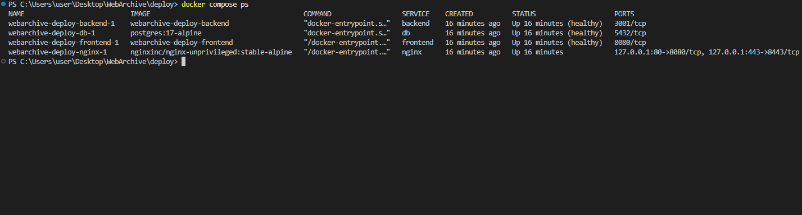
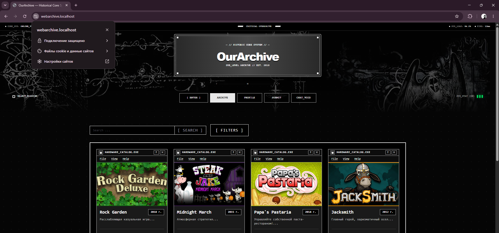
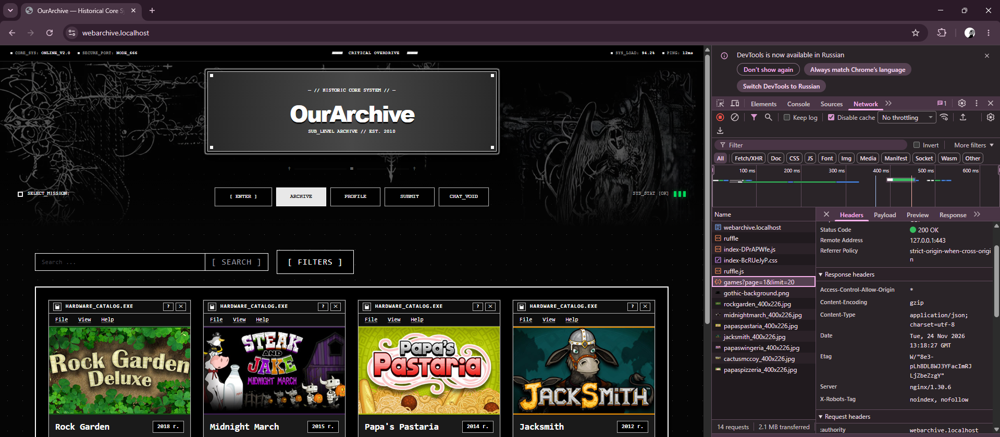
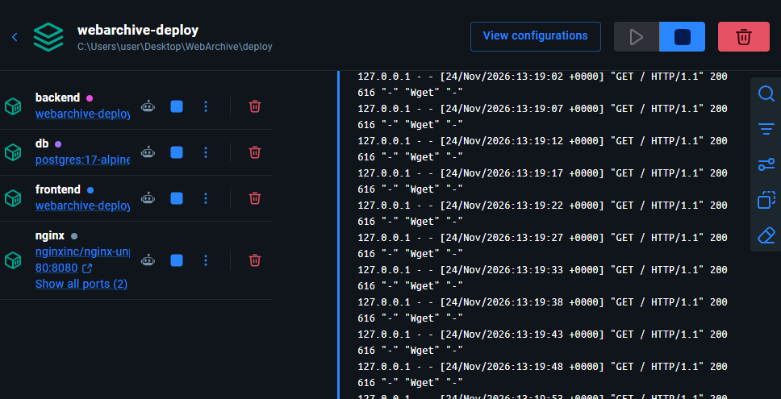

# Практическое занятие №18

Деплой приложения на выбранный хостинг: настройка серверов, SSL, домен, интеграция с CI/CD.

Студент: **Мишуков Роман Александрович**. Группа: **ПР-25.106**.

## Цель и архитектура

Локальная репетиция развёртывания OurArchive. Адрес: https://webarchive.localhost.
Публикации приложения в Интернет нет. Входные порты привязаны к 127.0.0.1.


| Сервис | Технология | Внутренний порт | Продакшен-сервер | Порт компьютера |
| --- | --- | --- | --- | --- |
| nginx | nginx, TLS | 8080, 8443 | nginx, непривилегированный пользователь | 127.0.0.1:80, 127.0.0.1:443 |
| frontend | React, Vite, Tailwind | 8080 | nginx, непривилегированный пользователь | Нет |
| backend | Node.js 22, Express | 3001 | node index.js, USER node | Нет |
| db | PostgreSQL 17 | 5432 | postgres | Нет |

База деплоя независима от существующего локального Supabase. При первом запуске SQL из `db/` создаёт три таблицы и заполняет каталог семью играми и тегами. При последующих запусках используется постоянный том `postgres_data`; SQL инициализации повторно не выполняется.

Фронтенд работает без SSR. В браузере используются относительные адреса `/api/`, `/covers/`, `/games/`. Переменные `VITE_*` и секреты для сборки ему не нужны. Ruffle пока подключён из внешнего CDN unpkg: для первоначальной загрузки эмулятора требуется Интернет.

## Переменные и секреты

| Имя | Где используется | Назначение |
| --- | --- | --- |
| POSTGRES_PASSWORD | deploy/.env, db и backend | Секрет: пароль отдельной учебной базы |
| POSTGRES_DB, POSTGRES_USER | db | Имя базы и пользователь |
| PGHOST, PGPORT, PGDATABASE, PGUSER | backend | Соединение с сервисом db |
| PGPASSWORD | backend | Пароль из POSTGRES_PASSWORD |
| NODE_ENV | backend | Режим production |
| PORT | backend | Внутренний порт API |
| TRUST_PROXY | backend | Доверие одному входному прокси |
| DATABASE_URL | Только разработка, BackEnd/.env | Альтернативная строка подключения; в Compose не передаётся |
| GITHUB_TOKEN | GitHub Actions | Встроенный токен для публикации образов в GHCR |

Значения секретов в отчёт не включаются. `.env`, сертификаты и закрытые ключи исключены из Git и контекста сборки. Сертификаты подключаются в nginx только при запуске, в режиме чтения. Корневой ключ mkcert не передавать и не добавлять в репозиторий.

## Подготовка и запуск

Требуются Docker Desktop с Linux-контейнерами, PowerShell 7, mkcert и Chrome или Edge.

На новом компьютере установить mkcert из официального репозитория:

```powershell
winget install --id FiloSottile.mkcert -e
```

Открыть новый PowerShell, перейти в `deploy` и подготовить пароль и сертификат:

```powershell
./setup.ps1
docker compose config --quiet
docker compose up --build -d
docker compose ps
```

Если Windows попросит подтвердить установку локального CA, подтвердить её самостоятельно. Утилита mkcert создаёт доверенный сертификат для `webarchive.localhost`, `localhost`, `127.0.0.1`.

Открыть https://webarchive.localhost. По адресу http://webarchive.localhost должен возвращаться 301 на HTTPS. Домен регистрировать и редактировать hosts для Chrome/Edge не требуется.

```powershell
docker compose logs --tail 100 backend nginx
docker compose down
docker compose up -d
```

`down` сохраняет том базы. После изменения кода выполнять `docker compose up --build -d`. Не использовать `down -v`, если нужно сохранить данные.

Команды в корне репозитория для этой работы: `docker compose -f deploy/docker-compose.yml --env-file deploy/.env up --build -d`. Корневой старый Compose запускает только фронтенд и не заменяет конфигурацию работы №18.

## Проверка

- Все четыре сервиса запущены; db, backend и frontend проходят healthcheck.
- Каталог содержит семь игр, поиск работает, `/api/filters` возвращает теги.
- Карточка открывает `/game/:id`; прямое открытие страницы работает через SPA fallback.
- Обложки и SWF возвращаются через HTTPS с того же домена, без mixed content.
- `/api/health` проверяет доступ к базе; ответ API содержит `X-Robots-Tag: noindex, nofollow`.
- Только nginx публикует порты на компьютере; db и backend не имеют опубликованных портов.
- После остановки и повторного запуска данные сохраняются.
- В DevTools → Network проверить `/api/games`, статус 200 и заголовки ответа.

На 24.11.2026 локальная сборка фронтенда и обоих Docker-образов успешна, 6 тестов Vitest проходят. Скрипт `./verify.ps1` выполнил 38 проверок HTTPS, API, поиска, пагинации, тегов, страниц всех семи игр, обложек и SWF. Сертификат проверен штатным TLS-клиентом Windows/.NET без отключения проверки доверия. Результаты сохранены в [verification.txt](verification.txt), состояние контейнеров — в [compose-ps.txt](compose-ps.txt).

Те же 6 тестов дополнительно прошли в Linux-контейнере Node.js 22, собранном из этапа builder фронтенда, без доступа к сети. Это проверка совместимости с окружением CI; удалённый GitHub Actions ещё не запускался.

Бэкенд запущен с UID 1000, оба nginx — с UID 101. `.env` и оба файла сертификата проверены через `git check-ignore`: они не попадут в репозиторий. Существующие заглушки профиля, чата, комментариев и кнопки фильтров не относятся к выполнению деплоя.

Постоянство данных проверено через `docker compose down` и `docker compose up -d --wait`: идентификатор кластера PostgreSQL до и после пересоздания контейнеров совпал, в таблице applications осталось 7 записей, повторные 38 проверок прошли. Исходный Supabase не изменялся.

Браузерную проверку выполнил студент: по его подтверждению сайт и игры работают. Скриншоты Chrome показывают защищённое соединение, загруженный каталог, ответ API 200 OK и заголовок X-Robots-Tag. Состояние контейнеров подтверждено снимками PowerShell и Docker Desktop. Автоматическое управление браузером ранее было остановлено проверкой допустимости адреса; проверка студента завершила этот этап.

## Скриншоты

Снимки сохранены в `deploy/screenshots/` и проверены.

### Состояние сервисов



### Сайт и защищённое соединение



### Запрос API



### Docker Desktop



После отправки изменений и успешного запуска GitHub Actions можно добавить `github-actions.png`. Удалённый CI пока не проверен.

## Обнаруженные ошибки и исправления

| Проблема | Исправление |
| --- | --- |
| Vitest: document is not defined | Добавлены jsdom, setupFiles и очистка DOM между тестами |
| Тесты ожидали прежние данные и callback onOpen | Тесты обновлены под API, activeTab и ссылку в новой вкладке |
| SWF загружался с http://localhost:3001 | Используется относительный HTTPS-совместимый путь /games/ |
| В режиме разработки не проксировался /games | Добавлен прокси Vite |
| Compose содержал только фронтенд | Создана полная конфигурация четырёх сервисов |
| Имя Dockerfile отличалось регистром от пути в CI | В Compose и CI явно указано FrontEnd/dockerfile |
| Старые зависимости MSSQL при использовании PostgreSQL | Удалены неиспользуемые mssql и msnodesqlv8, обновлён lockfile |
| Внешние запросы раскрывали сообщение ошибки БД | API возвращает общий код DB_ERROR |
| Встроенный браузер не принял новый локальный CA | Проверка доверия выполнена Windows/.NET; визуальную проверку выполнить в Chrome/Edge |

## CI и доставка

Workflow `.github/workflows/docker-publish.yml` запускается по push, pull_request и вручную. Сначала проходят тесты фронтенда, затем матрица собирает образы frontend и backend. На main образы публикуются в GHCR с разными именами; на других ветках и pull request проверяется сборка. Пароль базы и сертификаты для сборки не нужны.

Удалённый запуск workflow нужно подтвердить на GitHub после отправки изменений. Локальная сборка не доказывает успешный запуск GitHub Actions. Автоматическое обновление локального деплоя из реестра в обязательную часть не входит и пока не настроено.

## Что изменить для реального сервера

Выбрать сервер и зарегистрированный домен, настроить DNS, выпустить сертификат публичного CA с автоматическим продлением, открыть нужные сетевые порты и заменить привязки 127.0.0.1. Настроить серверные секреты, резервное копирование базы, мониторинг и доставку проверенных образов из реестра. Перед публикацией отдельно проверить безопасность и применимые требования к данным пользователей.


