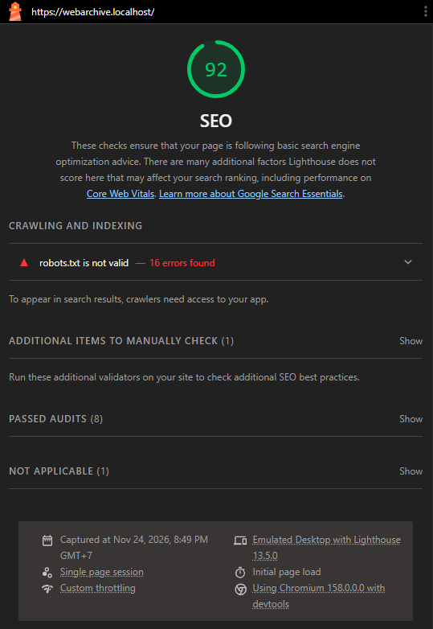
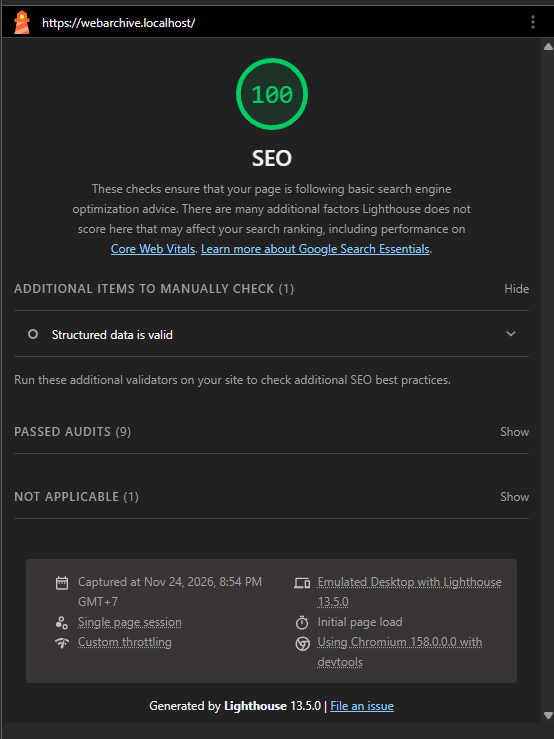

# Основы SEO: практическая часть занятий 70–71

Студент: Мишуков Роман Александрович. Группа: ПР-25.106.

Проект: OurArchive, React + Vite, Express, PostgreSQL, nginx.
Адрес проверки: https://webarchive.localhost/.

## Замеры Lighthouse

Оба замера проводятся на главной странице продакшен-сборки в Docker, в окне инкогнито, с одинаковыми настройками: Navigation, Desktop, SEO.

| Этап | Оценка SEO | Скриншот |
| --- | --- | --- |
| До изменений | 92 | before.png |
| После изменений | 100 | after.png |

Результат: SEO вырос с 92 до 100 баллов (+8). До изменений было 8 пройденных автоматических проверок, после — 9; ошибка невалидного robots.txt устранена. Оба результата подтверждены сохранёнными снимками Lighthouse 13.5.0, Chromium 158, Desktop. Оценка 100 относится к автоматическим проверкам SEO главной страницы и не заменяет полный аудит всех страниц, производительности и доступности.

Исходный замер: 24.11.2026, Lighthouse 13.5.0, Chromium 158, Desktop. На снимке отмечено `robots.txt is not valid — 16 errors found`: отсутствующий robots.txt отдавался как HTML главной страницы из-за SPA fallback.

Повторный замер: 24.11.2026. Непройденных автоматических проверок SEO на снимке нет. Пункт Structured data is valid отмечен как требующий ручной проверки; наличие и корректность структурированных данных этим замером не подтверждены.

## Исходное состояние

- Уже есть lang="ru", charset UTF-8, viewport, общий title и description.
- Описание «OurArchive — historical core system.» мало объясняет назначение сайта.
- В каталоге заголовок h1 сменяется названиями карточек h3, уровень h2 пропущен.
- На странице игры два h1: название сайта и название игры.
- В public отсутствуют robots.txt и sitemap.xml.
- Ответы API уже содержат X-Robots-Tag: noindex, nofollow благодаря nginx из работы №18.

## Адреса и индексация

| Адрес | Назначение | Решение |
| --- | --- | --- |
| / | Публичный каталог | Включить в sitemap |
| /game/1–/game/7 | Публичные страницы семи игр | Включить в sitemap |
| /api/ | JSON API и служебная проверка готовности | Disallow в robots.txt; X-Robots-Tag уже настроен |
| /games/ | Файлы SWF, не страницы игр | Не включать в sitemap |
| /covers/, /assets/ | Изображения и ресурсы приложения | Не включать в sitemap, не блокировать необходимые ресурсы |

Самостоятельных адресов входа, регистрации, профиля и админ-панели в текущем проекте нет. Кнопки ENTER, PROFILE, SUBMIT и CHAT_VOID показывают заглушки на том же адресе /. Поэтому не создаются вымышленные закрытые маршруты и не добавляется noindex на публичный каталог. Когда появятся приватные страницы, потребуются серверная авторизация и отдельные правила индексации.

robots.txt управляет сканированием и не заменяет авторизацию. Страницы, исключаемые через noindex, должны оставаться доступными для чтения этой директивы поисковым роботом.

## Выполненные изменения

1. Сохранены lang="ru", charset и viewport. Общий title изменён на «OurArchive — каталог классических флеш-игр», description описывает каталог, поиск и запуск через Ruffle.
2. На главной сохранён один h1 «OurArchive», названия карточек теперь h2. На странице игры бренд отображается как p с тем же стилем, единственный h1 — название игры, раздел комментариев — h2. Размер бренда задаётся классом brand-title, а не всем элементам h1.
3. В FrontEnd/public добавлен robots.txt: запрещено сканирование /api/, указан абсолютный адрес карты сайта.
4. В FrontEnd/public добавлена XML-карта восьми публичных страниц: / и /game/1–/game/7. Файлы копируются Vite в dist и обслуживаются nginx. Для этих двух адресов настроен точный try_files с 404 вместо HTML приложения, если файл отсутствует.
5. X-Robots-Tag для API сохранён из предыдущей работы; повторная проверка выполняется через общий HTTPS-вход nginx. API не опубликован на отдельном порту компьютера, поэтому собственный robots.txt для отдельного API-домена не требуется.

